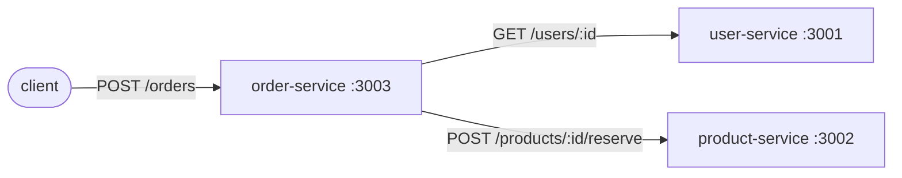

# Microservices Demo: Mini Online Shop

Three small, independently deployable services written in TypeScript (Express, Node 22).
Each service has its own codebase, its own data store (in-memory) and its own container.



| Service           | Port | Responsibility                                  |
| ----------------- | ---- | ----------------------------------------------- |
| `user-service`    | 3001 | Owns users (list, get, create)                  |
| `product-service` | 3002 | Owns products and stock levels, reserves stock  |
| `order-service`   | 3003 | Creates orders by orchestrating the other two   |

## Concepts demonstrated

- **Single responsibility / database per service**: no service reads another's data directly, only via its HTTP API.
- **Synchronous service-to-service communication**: `order-service` calls the other two over REST.
- **Service discovery via DNS**: in Docker Compose, services reach each other by name (`http://user-service:3001`), configured through environment variables.
- **Failure handling**: unknown user → `404`, insufficient stock → `409`, dependent service down → `503`.
- **Independent deployability**: each service builds and runs on its own (`Dockerfile` per service).
- **Health checks**: every service exposes `GET /health`.

## Run with Docker

```bash
docker compose up --build
```

## Run locally (without Docker)

```bash
for s in user-service product-service order-service; do (cd $s && npm install); done
(cd user-service && npm run dev) &
(cd product-service && npm run dev) &
(cd order-service && npm run dev)
```

## Try it

```bash
# Seed data: users u1, u2; products p1 (stock 10), p2 (stock 3)
curl localhost:3001/users
curl localhost:3002/products

# Place an order (order-service calls user-service and product-service)
curl -X POST localhost:3003/orders \
  -H 'Content-Type: application/json' \
  -d '{"userId":"u1","productId":"p2","quantity":2}'

# Stock of p2 is now 1
curl localhost:3002/products/p2

# Not enough stock → 409
curl -i -X POST localhost:3003/orders \
  -H 'Content-Type: application/json' \
  -d '{"userId":"u1","productId":"p2","quantity":5}'

# Unknown user → 404
curl -i -X POST localhost:3003/orders \
  -H 'Content-Type: application/json' \
  -d '{"userId":"nope","productId":"p1","quantity":1}'

# Resilience: stop a dependency and place an order → 503
docker compose stop product-service
curl -i -X POST localhost:3003/orders \
  -H 'Content-Type: application/json' \
  -d '{"userId":"u1","productId":"p1","quantity":1}'
```

## Limitations (good discussion points for the write-up)

- Data is in-memory and lost on restart; a real system would use a database per service.
- Synchronous calls couple availability: if `product-service` is down, orders fail. An event-driven design (message broker) would decouple them.
- No distributed transaction: if order creation failed after stock reservation, the stock would need a compensating action (saga pattern).
- No API gateway, authentication, retries or timeouts.
